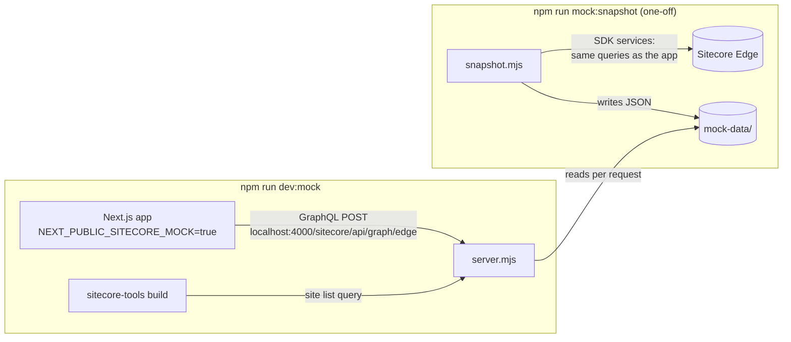

# Local Sitecore mock

Run the head app without Sitecore. A small local GraphQL server stands in for Sitecore
Experience Edge and answers the app's content queries from JSON files in `mock-data/`.
A snapshot script fills those files from a real Sitecore instance, and you can edit or
write them by hand.

- [Quick start](#quick-start)
- [How it works](#how-it-works)
- [Commands](#commands)
- [Configuration](#configuration)
- [Fixture files](#fixture-files)
- [Keeping fixtures in step with field types](#keeping-fixtures-in-step-with-field-types)
- [Query handling](#query-handling)
- [Common tasks](#common-tasks)
- [Troubleshooting](#troubleshooting)
- [Limitations](#limitations)
- [File reference](#file-reference)

## Quick start

```bash
# 1. Optional: capture real content (needs Sitecore credentials in .env.local)
npm run mock:snapshot -- --site my-site --limit 25

# 2. Run the app against the mock
npm run dev:mock
```

Open `http://localhost:3000/` (or the port in `PORT`). No Sitecore credentials or
network access are needed for step 2. `npm run dev` is unchanged and still uses Sitecore.

## How it works



1. **The app only talks to Sitecore over GraphQL.** The Content SDK accepts a "local"
   API (`api.local.apiHost` + `apiKey`) and sends every query to
   `${apiHost}/sitecore/api/graph/edge`.
2. **`sitecore.config.ts` switches to the mock** when `NEXT_PUBLIC_SITECORE_MOCK=true`:
   it sets `api.local` to `http://localhost:4000` and clears the Edge context IDs. The
   clearing matters: when an Edge context ID is set (from `.env.local`), the SDK always
   prefers Edge over `api.local`.
3. **`server.mjs` recognizes each query** (layout, dictionary, site list, routes),
   reads the matching fixture file and returns it in the shape the SDK expects.
   Anything it doesn't recognize gets an empty result, which the SDK treats as "not
   found" or "not configured".
4. **`snapshot.mjs` uses the SDK's own services** (`LayoutService`, `DictionaryService`,
   `SiteInfoService`, `SitePathService`), so it sends exactly the queries the app sends,
   and saves the results as fixtures.

The app code (pages, proxy, components) is unchanged. Only the GraphQL endpoint differs.

## Commands

| Command | What it does |
|---|---|
| `npm run dev:mock` | Starts the mock server, the field sync watcher and `npm run dev` together, with `NEXT_PUBLIC_SITECORE_MOCK=true`. |
| `npm run mock:server` | Starts only the mock server on port 4000. Useful when running the app another way. |
| `npm run mock:sync` | Checks every fixture against the components' field types. Exits 1 when they drifted. Add `-- --write` to fix. |
| `npm run mock:sync:watch` | Re-syncs on every component change and gives new components a page. Part of `dev:mock`. |
| `npm run mock:snapshot -- <options>` | Captures content from Sitecore into `mock-data/`. Reads `.env` and `.env.local`. |

### Snapshot options

| Option | Default | Description |
|---|---|---|
| `--site <name[,name]>` | `NEXT_PUBLIC_DEFAULT_SITE_NAME` | Site(s) to capture. Repeat the flag or comma-separate. Names are matched case-insensitively against Sitecore's site list. |
| `--routes </a,/b>` | crawl | Capture only these routes. Without it, the script lists the site's routes from Sitecore and captures them. |
| `--limit <n>` | `100` | Maximum routes per site when crawling. `/` is always included. |
| `--lang <code>` | site's language, else `en` | Language to capture. |
| `-h`, `--help` | | Print usage. |

Examples:

```bash
npm run mock:snapshot -- --site my-site                       # crawl up to 100 routes
npm run mock:snapshot -- --site my-site --limit 20
npm run mock:snapshot -- --site my-site,other-site --routes /,/about-us
npm run mock:snapshot -- --site my-site --lang en
```

Every run rewrites `mock-data/sites.json` and the dictionary for each captured site,
and writes (or overwrites) one file per captured route. It never deletes fixtures, so
routes captured earlier stay until you remove them. Routes Sitecore reports as missing
are listed and skipped.

## Configuration

| Variable | Used by | Purpose |
|---|---|---|
| `NEXT_PUBLIC_SITECORE_MOCK` | app | `true` switches `sitecore.config.ts` to the mock. Set by `npm run dev:mock`; you don't need it in `.env.local`. It's a `NEXT_PUBLIC_` variable so the browser bundle uses the mock too. |
| `SITECORE_MOCK_DATA_DIR` | server, snapshot, sync | Fixture folder. Default `mock-data` (relative to the project root). |
| `SITECORE_COMPONENT_ROOT` | sync | Component folder whose field types the sync reads. Default `src/components`. |
| `NEXT_PUBLIC_DEFAULT_LANGUAGE` | server | Language used when a layout query has none. Default `en`. |
| `SITECORE_EDGE_CONTEXT_ID` | snapshot | Edge credentials to snapshot from. |
| `SITECORE_API_HOST` + `SITECORE_API_KEY` | snapshot | Alternative: snapshot from a local CM (`NEXT_PUBLIC_` variants also work). |
| `SITECORE_EDGE_PLATFORM_HOSTNAME` | snapshot | Non-default Edge hostname (`NEXT_PUBLIC_` variant also works). |
| `NEXT_PUBLIC_DEFAULT_SITE_NAME` | snapshot | Site captured when `--site` is omitted. |

**Port:** the mock always listens on `4000`. To change it, update `MOCK_PORT` in
`fixtures.mjs` and the `apiHost` in `sitecore.config.ts`.

## Fixture files

```
mock-data/
  sites.json                               site list
  <site>/<lang>/dictionary.json            dictionary phrases
  <site>/<lang>/routes/_root.json          page at "/"
  <site>/<lang>/routes/about-us.json       page at "/about-us"
  <site>/<lang>/routes/about-us/team.json  page at "/about-us/team"
  <site>/<lang>/partial-design.json        renderings added to every page (optional)
```

Route paths are lowercased and trailing slashes are ignored, so `/About-Us/` reads
`about-us.json`. `/` is stored as `_root.json`.

### `partial-design.json`

Renderings shared by every page of a site, such as the header and footer. Sitecore
does this with partial designs: it merges their renderings into each page's layout
response, so the head app sees them as ordinary placeholder content. The mock does
the same. Before returning any route, it adds these renderings to the route's
placeholders, ahead of the route's own.

```jsonc
{
  "placeholders": {
    "headless-footer": [
      { "uid": "…", "componentName": "Footer", "dataSource": "{…}", "params": {}, "fields": { … } }
    ]
  }
}
```

In this repo the `uso` site's Footer (with its `footer-cta` card) lives here, so every
page gets it. Changes apply on the next request, with no restart. Snapshotted pages
already contain their partial-design renderings, so don't add a `partial-design.json`
for a captured site or those renderings appear twice.

### `sites.json`

The site list Sitecore returns. `sitecore-tools project build` turns it into
`.sitecore/sites.json`, which the multisite proxy uses to pick a site from the request
hostname.

```json
[
  { "name": "uso", "hostName": "localhost|127.0.0.1", "language": "en" }
]
```

`hostName` can hold several hosts separated by `|`, `,` or `;`, and `*` wildcards.
Exact hosts win over wildcards, so adding `localhost` to a site makes it the site for
`http://localhost:<port>/` even when another uses `*`. That matters even with one site:
when `NEXT_PUBLIC_DEFAULT_SITE_NAME` is set, `sitecore-tools project build` adds that site
to the front of `.sitecore/sites.json` with hostName `*`. In this repo the only site is
`uso`, with `localhost|127.0.0.1`, so it wins over the added `Default` site locally.

### `dictionary.json`

A flat object of phrases. `src/pages/_app.tsx` passes it to `next-localization`'s
`I18nProvider`, so components read it with `useI18n()`:

```json
{ "Header.Search": "Search", "Footer.Copyright": "© 2026" }
```

### Route files (`routes/**/*.json`)

The layout Sitecore renders for a page: `{ sitecore: { context, route } }`. This is
exactly what `client.getPage()` receives, so components see the same props as in
production.

```jsonc
{
  "sitecore": {
    "context": {
      "pageEditing": false,
      "site": { "name": "uso" },
      "pageState": "normal",
      "language": "en",
      "itemPath": "/"
    },
    "route": {
      "name": "USO",
      "fields": {
        "Title": { "value": "USO" }            // page fields
      },
      "placeholders": {
        "headless-header": [],
        "headless-main": [
          {
            "uid": "5d2e9b1a-3c4f-4a6b-8d7e-9f0a1b2c3d4e",
            "componentName": "Title",            // must match a component in the component map
            "dataSource": "{8C3F2A1B-4D5E-4F6A-9B7C-1D2E3F4A5B6C}",
            "params": {},                         // rendering parameters (styles, etc.)
            "fields": {
              "Title": { "value": "Welcome to USO" }  // datasource fields
            }
          }
        ],
        "headless-footer": []
      }
    }
  }
}
```

- `route.placeholders` keys must match the placeholders the layout renders:
  `headless-header`, `headless-main` and `headless-footer` in `src/Layout.tsx`.
  Components can define nested placeholders under their own `placeholders` key.
- `componentName` picks the React component from `.sitecore/component-map.ts`. An
  unknown name renders the SDK's orange "missing React implementation" box.
- Field values use the usual Sitecore shapes: `{ "value": "text" }` for text and rich
  text, `{ "value": { "href": "/x", "text": "Go" } }` for links,
  `{ "value": { "src": "https://...", "alt": "", "width": 800, "height": 600 } }` for
  images. For other field types, snapshot a real page that uses them and copy its shape.
- Ignore the `uid` and GUID values: any unique string works.

## Keeping fixtures in step with field types

`sync-fields.mjs` reads each component's `<Name>Fields` type with the TypeScript compiler
and checks every `<Name>` rendering in the fixtures against it, so a field added to a type
shows up in mock data without hand-editing JSON.

- **Where the type lives:** `<Name>.fields.ts`, else `<Name>.tsx`, next to the component.
  The component name is the file name, as in the component map.
- **Field kinds** come from the Content SDK types: `Field<string>`, `Field<number>`,
  `Field<boolean>`, `RichTextField`, `LinkField`, `ImageField`, `FileField`, arrays of
  items with `fields` (Multilist / Treelist) and single items (Droplink / Droptree).
- **Values for new fields** come from the `<name>SampleFields` export of the fields file
  (the Figma sample content Storybook also uses), else a placeholder of the right shape:
  `Sample <Field>` text, a `#` link, an offline SVG image, three list items.
- **Existing values are kept.** Only additions and renames are applied by `--write`.

| Mark | Meaning | Applied by |
|---|---|---|
| `+` | The type has a required field the fixture lacks | `--write` |
| `~` | One field missing and one unknown field of the same shape: treated as a rename, value kept | `--write` |
| `-` | The fixture has a field the type doesn't | `--prune` |
| `!` | A value doesn't have its type's shape, e.g. text where a link is expected | `--prune` (replaced) |

```bash
npm run mock:sync                                  # report only; exit 1 on drift (CI, pre-commit)
npm run mock:sync -- --write                       # add missing fields, apply renames
npm run mock:sync -- --write --prune               # also drop unknown fields, fix wrong shapes
npm run mock:sync -- --write --scaffold            # also add /components/<kebab-name> pages
```

`--scaffold` gives every component that no fixture uses a one-rendering page at
`routes/components/<kebab-name>.json`, for each site and language in `sites.json`. It
never overwrites an existing page; delete the file to regenerate it from the latest
sample fields.

During `npm run dev:mock` the watcher (`--watch --scaffold`) re-runs on every change in
`src/components`, so a new field or a new component appears on the next page reload.
Renderings without a datasource are skipped: they have no datasource fields.

## Query handling

`server.mjs` checks queries in this order. The first match wins.

| Query | Recognized by | Fixture | Response when missing |
|---|---|---|---|
| Layout (`client.getPage`) | `layout(site:"…", routePath:"…", language:"…")` | `<site>/<lang>/routes/<path>.json`, plus `<site>/<lang>/partial-design.json` merged in | `layout: null`, so the app shows its 404 page. The server logs `no fixture for <site> <lang> <path>`. |
| Dictionary (`client.getDictionary`) | `dictionary(` | `<site>/<lang>/dictionary.json` | Empty dictionary. |
| Site list (`sitecore-tools project build`) | `siteInfoCollection` | `sites.json` | Empty list. |
| Site routes (static paths) | `routes(` | Lists the route files on disk | Empty list. |
| Other `siteInfo(…)` queries: error pages, robots, redirects, sitemap, llms.txt | `siteInfo(` | none | `site.siteInfo: null` ("not configured"). |
| Anything else | | none | `{}` and an `[mock] unhandled <operation>` log line. |

The server answers `GET /` with a status JSON (`{ "status": "ok", "mockDataDir": … }`),
which is a quick way to check it's running. It sends permissive CORS headers so
browser-side GraphQL calls work too.

## Common tasks

### Add a page by hand

1. Copy an existing route file, e.g. `routes/_root.json` to `routes/events.json`.
2. Edit `route.name`, `context.itemPath`, page fields and placeholders.
3. Open `/events`. No restart needed: route files are read on every request.

### Make a page the home page

Save it as `routes/_root.json`. The USO page in this repo is set up this way.

### Put a component on every page

Add its rendering to `partial-design.json` under the placeholder it belongs in
(`headless-header`, `headless-main` or `headless-footer`). Keep it out of the route
files, or it renders twice. In Sitecore, the same rendering goes in a partial design
used by the site's page design.

### Add a component and see it with mock data

1. Create it under `src/components/`, e.g. `src/components/title/Title.tsx`. While
   `npm run dev:mock` runs, the component map watcher registers it automatically.
   Otherwise run `npm run sitecore-tools:generate-map`.
2. Add a rendering with that `componentName` to a route file's placeholder, with the
   `fields` and `params` the component expects.
3. Reload the page.
4. Optionally, add a Storybook story next to the component (`<Name>.stories.ts`).
   `sitecore.cli.config.ts` excludes `*.stories.*` and `*.fields.*` from the component
   map. See `src/components/single-cta/SingleCta.stories.ts`: stories can pass a mock
   page through `parameters.sitecore.page` and child components through
   `parameters.sitecore.componentMap`, and `play` functions show PASS/FAIL in the
   Interactions panel.

### Test edge cases

Edit fixture values directly: empty strings, very long text, missing images, extra
items in a list. This is the main advantage over a live Sitecore instance.

### Add another site

Add an entry to `mock-data/sites.json` and a `mock-data/<name>/<lang>/` folder, then
restart `npm run dev:mock`. With several sites, give the one you want on localhost a
`localhost` host (exact hosts beat `*`), or pick a site per request with `?sc_site=<name>`.

### Refresh from Sitecore

Re-run `npm run mock:snapshot`. Hand edits to captured routes are overwritten, and
`sites.json` is replaced with Sitecore's site list. The `uso` site exists only in the
mock, so add its entry back to `sites.json` afterwards (and decide which site gets
`localhost`).

## Troubleshooting

| Symptom | Cause and fix |
|---|---|
| Every page is a 404 | The request resolved to a site with no fixture, often `Shared Site` / `Default` (hostName `*`). Check the server log line `no fixture for <site> <lang> <path>`. Add `localhost` to the right site in `sites.json`, or use `?sc_site=`. |
| Changes to `sites.json` don't apply | The site list is read at startup by `sitecore-tools project build`. Restart `npm run dev:mock`. |
| Dictionary changes don't show | The SDK caches dictionaries for 60 seconds. Wait or restart. |
| Requests still go to Sitecore | The app was started with `npm run dev` instead of `npm run dev:mock`, so `NEXT_PUBLIC_SITECORE_MOCK` isn't set. |
| `EADDRINUSE :4000` | Another mock server, or another app, is using port 4000. Stop it, or change the port (see [Configuration](#configuration)). |
| `[MV-007] Provide either "contextId" or both "apiHost" and "apiKey"` | The mock switch is off and `.env.local` has no Sitecore credentials. Start with `npm run dev:mock`, not `npm run dev`. |
| Orange "missing React implementation" boxes | The fixture references a `componentName` that doesn't exist in `src/components/` yet. |
| `Missing Sitecore credentials` from the snapshot | Set `SITECORE_EDGE_CONTEXT_ID` in `.env.local`. Only the snapshot needs it. |

## Limitations

- Only pages with a route file exist. Everything else returns the 404 page.
- Images and media URLs in fixtures still point at Sitecore's media servers, so they
  don't load offline.
- Page Builder editing, preview, personalization and redirects are off in mock mode.
- Error pages, robots.txt, sitemap.xml and llms.txt behave as "not configured".
- Captured content is a point-in-time copy. It doesn't update until you re-snapshot.

## File reference

| File | Role |
|---|---|
| `scripts/mock-sitecore/server.mjs` | The mock GraphQL server, its query handlers, and the partial-design merge. |
| `scripts/mock-sitecore/snapshot.mjs` | Captures fixtures from Sitecore through the SDK services. |
| `scripts/mock-sitecore/sync-fields.mjs` | Checks and updates fixtures against the components' field types. |
| `scripts/mock-sitecore/fixtures.mjs` | Shared fixture paths, JSON read/write, route listing, port. Refuses paths outside the fixture folder. |
| `sitecore.config.ts` | The `NEXT_PUBLIC_SITECORE_MOCK` switch. |
| `package.json` | `dev:mock`, `mock:server`, `mock:sync`, `mock:sync:watch` and `mock:snapshot` scripts. |
| `mock-data/` | The fixtures. |
| `.claude/launch.json` | `next-dev-mock` entry for Claude's browser preview (port 3001). |
